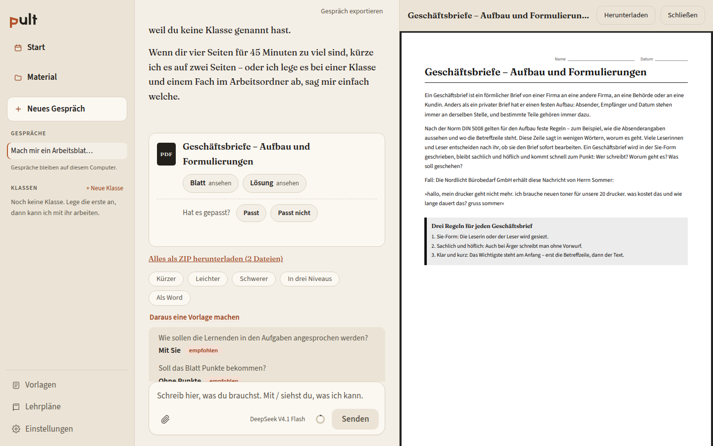
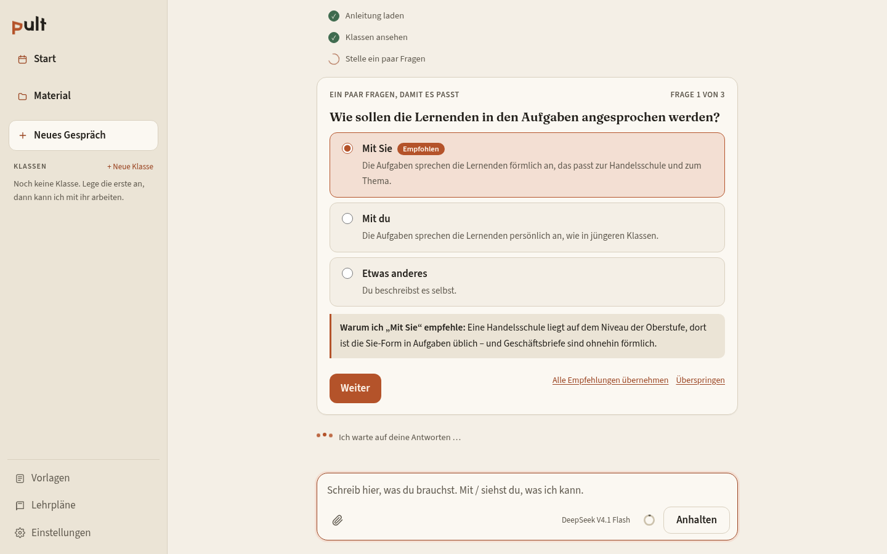
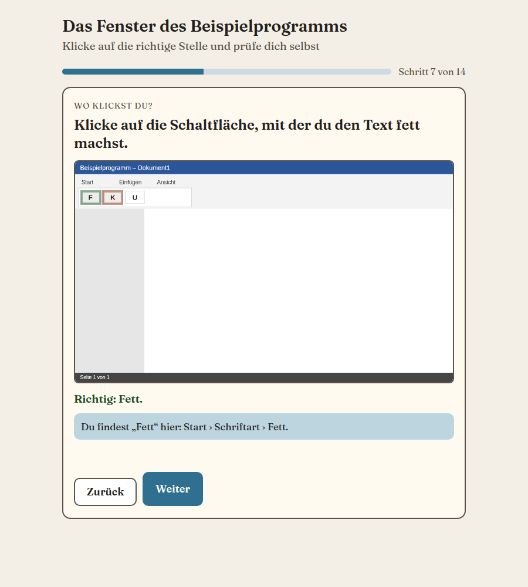

<p align="center">
  
</p>

<h3 align="center">Der ruhige KI-Arbeitsplatz für Lehrkräfte</h3>

<p align="center">
  Arbeitsblätter, Klausuren, Stundenplanung und mehr: Du sagst, was du brauchst, Pult fragt nach und erstellt druckfertiges Material.<br>
  Läuft auf deinem Computer. Open Source.
</p>

<p align="center">
  <a href="https://github.com/brandy299/morte/actions/workflows/ci.yml"></a>
  
  
  
</p>

<p align="center">
  
</p>

> **Probelauf.** Pult ist in Erprobung (Version 0.1.0). Es kann Fehler machen oder etwas nicht können. Ob ein Arbeitsblatt fachlich gut ist, beurteilt am Ende nur eine Lehrkraft.

*English in short: Pult is a lean, local AI workspace for teachers (worksheets, exams, lesson plans, interactive exercises). The interface and the material are in German. Apache-2.0, bring your own API key, nothing leaves your computer except the requests to the AI provider you choose.*

## Was Pult kann

| Du sagst … | Pult erstellt |
|---|---|
| „Arbeitsblatt zu Geschäftsbriefen“ | Druckfertiges PDF in Graustufen mit Lösungsblatt, auf Wunsch als Word-Datei. Zuordnungen, Lückentexte, Tabellen und Schaubilder baut das Programm, nicht das Modell, die Lösung passt immer zum Blatt |
| „Klausur mit Erwartungshorizont“ | Klausur und Erwartungshorizont nach deinen Bewertungsregeln (Anforderungsbereiche und Notenschlüssel trägst du selbst ein) |
| „Plan die Stunde am Mittwoch“ | Stundenverlauf mit Lernzielen, Phasen mit Minuten und Sozialformen als druckfertige Seite für dich |
| „Lernsituation zu …“ | Eine Lernsituation oder Reihe über mehrere Stunden, angelegt in der Klasse mit allen Stunden in der Stundentabelle, dazu ein druckfertiges Blatt |
| „Interaktive Übung“ | Eine einzelne HTML-Datei, die ohne Internet im Browser läuft: Auswahl, Lückentext, Zuordnung, „Wo klickst du?“ auf Bildschirmfotos aus deiner Bildbibliothek |
| „Erklärstück zum Wasserkreislauf“ | Eine animierte HTML-Datei, die du am Beamer abspielst |
| „Präsentation zu …“ | PowerPoint-Datei mit Schaubildern als echten Objekten |
| „Bau mir so ein Blatt wie auf dem Foto“ | Ein neues Blatt in der Machart des Fotos, mit eigenen Inhalten |
| „Differenzieren“, „Verständnis-Check“ | Ein Blatt in drei Niveaus (Basis, Standard, Erweiterung); ein kurzer Test zum Stundenende mit Lösungen und typischen Fehlvorstellungen |

Dazu: Klassen mit Stand und Reihen, dein **Stundenplan als Kalender (iCal)** mit Wochenansicht und „Material fehlt“, hinterlegte **Lehrpläne**, eigene **Vorlagen**, **Schulkopf** auf dem Material und unter jedem Material „Passt“ und „Passt nicht“ als Rückmeldung.

<p align="center">
  
  &nbsp;
  
</p>

## Ausprobieren

Das brauchst du: **Node.js** (nodejs.org, Version „LTS“) und einen Zugang zu einer KI (zum Beispiel OpenRouter, einmal etwa 10 Dollar Guthaben). Dann **eine Zeile** im Terminal:

- **Windows** (PowerShell):
  ```
  irm https://raw.githubusercontent.com/brandy299/morte/main/install.ps1 | iex
  ```
- **Mac** (Terminal):
  ```
  curl -fsSL https://raw.githubusercontent.com/brandy299/morte/main/install.sh | bash
  ```

Pult richtet sich beim ersten Mal selbst ein (zwei bis fünf Minuten) und öffnet den Browser. Dieselbe Zeile später noch einmal holt die neueste Fassung. Die Schritt-für-Schritt-Anleitung mit allen Antworten auf häufige Fragen: [Anleitung für Tester](docs/anleitung-tester.md), dazu [OpenRouter einrichten](docs/openrouter-anleitung.md) mit Bildern.

## So arbeitet Pult

- **Ein Agent mit festen Werkzeugen.** Der Assistent hat nur lehrerspezifische Werkzeuge (Klasse lesen, Arbeitsblatt erstellen, Stunde eintragen …), keine freie Shell. Vor Aktionen, die Vorhandenes ändern, fragt er in einfacher Sprache nach.
- **Rückfragen mit Empfehlung.** Fehlt etwas, stellt Pult wenige Fragen, jede mit einer empfohlenen Antwort und der Begründung dazu.
- **Das Programm prüft, das Modell schreibt.** Eingaben des Modells werden streng geprüft und in einfachen Worten zurückgemeldet. Layout, Lösung und Nummerierung kommen vom Programm.
- **Anbieter austauschbar.** Claude, OpenAI, OpenRouter, OpenCode Go, DeepSeek oder ein eigener OpenAI-kompatibler Server. Hauptmodelle müssen Bilder verstehen und Werkzeuge aufrufen, das wird getestet und erzwungen. Mit Prüfläufen messen wir, welche Modelle das Material verlässlich erstellen (`evals/`).
- **Lokal.** Klassen, Material und Gespräche liegen im Ordner `pult-daten` auf deinem Computer. Der Schlüssel liegt im Schlüsselbund des Betriebssystems.

## Datenschutz

Keine Schülernamen, keine Noten und keine Fotos von Klassenarbeiten in Pult eingeben. Deine Eingaben und angehängten Dateien gehen an den KI-Anbieter, den du gewählt hast. Außer diesen Anfragen (und der Abfrage deines Guthabens beim Anbieter) sendet Pult nichts. Es sammelt keine Nutzungsdaten. Testdaten im Repo sind frei erfunden.

## Für Entwicklerinnen und Entwickler

```
npm install
npm run dev        # Entwicklung: http://localhost:5173
npm test           # Tests
npm run typecheck  # Typen
npm run build      # Oberfläche bauen, danach: npm start (http://localhost:3001)
npm run eval       # Prüfläufe mit einem Sprachmodell als Prüfer, siehe evals/README.md
npm run zip        # Paket für Tester (ZIP mit Doppelklick-Start)
```

TypeScript, Node.js (ab 22), [Hono](https://hono.dev) als Server, React mit Vite als Oberfläche, pi-ai und pi-agent-core (`@earendil-works`, exakt gepinnt) als Agentenkern, den nur `src/core/agent` importiert.

| Ordner | Inhalt |
|---|---|
| `src/core/agent` | Agent, Werkzeuge, Anbieter und Modelle, Rückfragen |
| `src/core/material` | Arbeitsblatt, Klausur, Präsentation, Schaubilder, Formelsatz; PDF, Word, PowerPoint |
| `src/core/uebung`, `src/core/animation` | Interaktive Übung und Erklärstück als HTML |
| `src/core/workspace`, `stundenplan`, `lehrplan`, `history` | Arbeitsordner, Stundenplan, Lehrpläne, Gespräche |
| `src/server`, `src/web` | Server und Oberfläche |
| `skills/` | Die Anleitungen für den Assistenten (Agent Skills) |
| `evals/`, `src/core/eval` | Prüfläufe und Kriterien |
| `docs/` | Anleitungen, Entscheidungen, Recherche. Einstieg: [docs/README.md](docs/README.md) |
| `design/` | Logo und Vorschaubild |

Der Fahrplan steht in [ROADMAP.md](ROADMAP.md), die Arbeitsregeln (auch für KI-Agenten) in [CLAUDE.md](CLAUDE.md), die Grundsatzentscheidungen unter [docs/entscheidungen](docs/entscheidungen).

## Mitmachen

Fehler, Wünsche und Rückmeldungen sind willkommen, am liebsten als [Issue](https://github.com/brandy299/morte/issues/new/choose). Wie du etwas beiträgst, steht in [CONTRIBUTING.md](CONTRIBUTING.md). Sicherheitslücken bitte nicht öffentlich melden, siehe [SECURITY.md](SECURITY.md).

## Lizenz und Bibliotheken

Apache-2.0, siehe [LICENSE](LICENSE). Pult nutzt unter anderem [ical.js](https://github.com/kewisch/ical.js) (MPL-2.0) für den Stundenplan, [docx](https://github.com/dolanmiu/docx) (MIT) und [mammoth](https://github.com/mwilliamson/mammoth.js) (BSD-2-Clause) für Word, [pdfkit](https://github.com/foliojs/pdfkit) (MIT), [pptxgenjs](https://github.com/gitbrent/PptxGenJS) (MIT), [MathJax](https://www.mathjax.org) (Apache-2.0) für Formeln und [anime.js](https://animejs.com) (MIT) für Erklärstücke. Die Schriften Fraunces und Source Sans 3 stehen unter der SIL Open Font License, Hinweise in `assets/fonts/NOTICE.md`. Die Prüfläufe orientieren sich in der Form an [anthropics/k12-teacher-skills](https://github.com/anthropics/k12-teacher-skills) (Apache-2.0).
