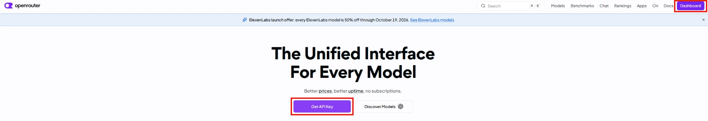
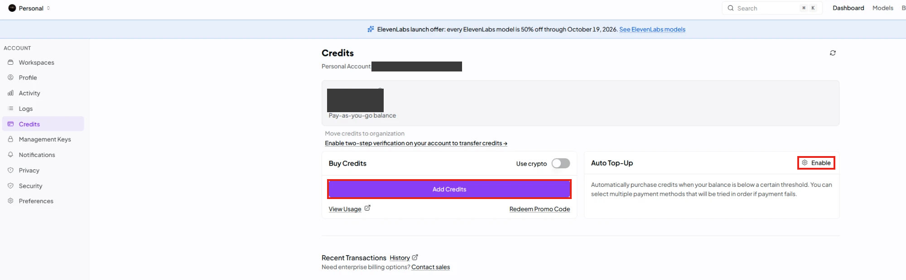
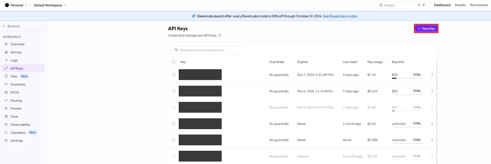
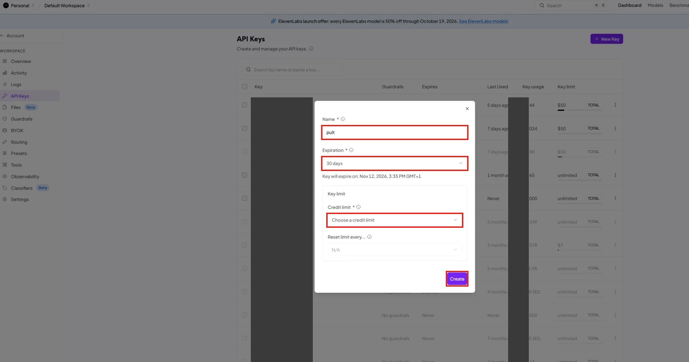
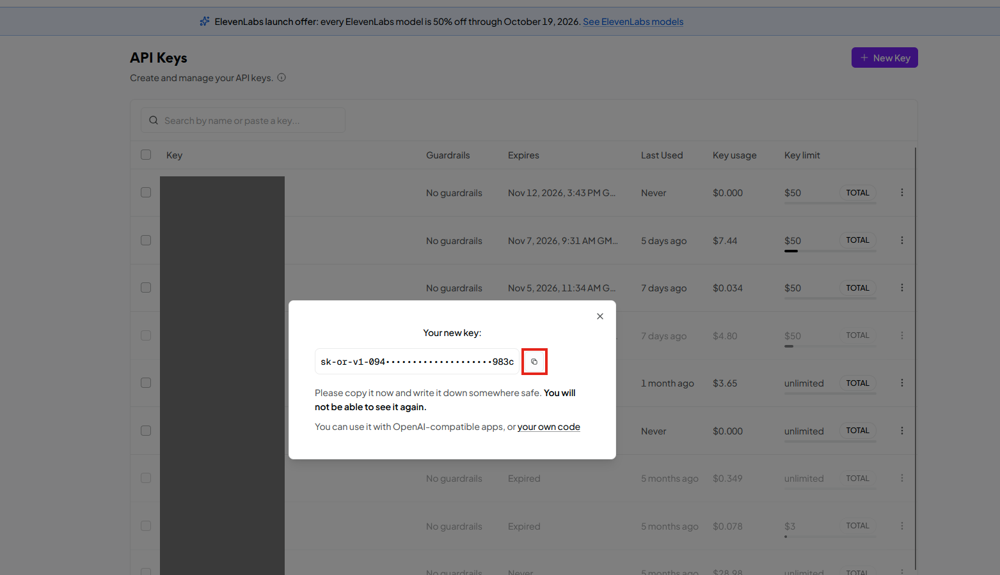
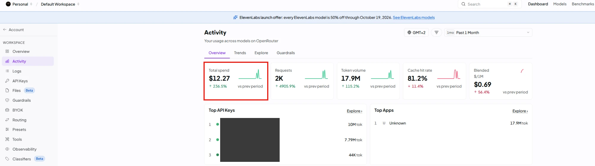

# OpenRouter einrichten: Schritt für Schritt

Stand: 2026-10-14. OpenRouter ist ein Zugang zu vielen KI-Modellen mit **einem** Konto, **einem** Guthaben und **einem** Schlüssel. Pult nutzt es, um Material zu erstellen. Du brauchst etwa 10 Minuten und eine Zahlungsart (Karte, PayPal oder was OpenRouter gerade anbietet).

## Was ist OpenRouter, und was zahle ich ein?

**Kurz gesagt:** OpenRouter ist wie eine **Prepaid-Karte für KI**. Du lädst einmal ein kleines Guthaben auf, und Pult darf davon so viel verbrauchen, wie es für dein Material braucht. Mehr nicht.

**Warum überhaupt?** Pult selbst ist nur die Werkstatt. Die „Denkarbeit“ macht eine KI (zum Beispiel von Anthropic, OpenAI oder DeepSeek), und die gehört Firmen, die dafür Geld nehmen, und zwar nach Verbrauch. Normalerweise bräuchtest du bei jeder Firma ein eigenes Konto. OpenRouter ist die **Sammelstelle**: ein Konto, ein Guthaben, ein Schlüssel, und dahinter viele KI-Modelle zur Auswahl. Pult schickt deine Anfrage an OpenRouter, und OpenRouter gibt sie an das Modell weiter.

**Wie bei einem Prepaid-Handy:**
- Du zahlst **vorher** ein kleines Guthaben ein. Es ist **kein Abo** und läuft nicht von allein weiter.
- Es wird nur abgezogen, wenn Pult etwas erstellt. Eine Anfrage kostet wenige Cent oder weniger.
- Ist das Guthaben leer, hört Pult einfach auf. Dann lädst du nach, wenn du magst.
- Du kannst nie mehr verlieren, als du eingezahlt hast, und mit der **Ausgabengrenze** am Schlüssel (Schritt 3) setzt du dir sogar eine zweite Sicherung.

**Wie viel einzahlen?** **10 Dollar** (ungefähr 9 bis 10 Euro, der Kurs schwankt). Das ist ein guter Start. Wie lange das reicht, wissen wir noch nicht genau: In unseren Tests kostete ein Prüflauf mit mehreren Gesprächen etwa 0,30 bis 0,60 Dollar. Du hast damit also eine Menge Spielraum. Lade nicht mehr auf, bis du gesehen hast, wie schnell das Guthaben sinkt. Das siehst du in Pult oben im Ring und bei OpenRouter unter „Activity“ (siehe unten).

**Wichtig zu wissen**
- **Ein ChatGPT- oder Claude-Abo, das du schon hast, zählt hier nicht.** Das sind getrennte Dinge. Für Pult brauchst du den Schlüssel von OpenRouter, und der wird getrennt abgerechnet.
- OpenRouter berechnet beim Aufladen eine kleine **Gebühr**. Die siehst du vor der Zahlung.
- Gezahlt wird in **US-Dollar**. Deine Karte rechnet um.
- Deine Eingaben in Pult gehen über OpenRouter an die KI. Schülernamen, Noten und Fotos von Klassenarbeiten gehören deshalb **nie** hinein.

---

**Zu den Bildern:** Sie zeigen die echte Oberfläche von OpenRouter (Stand 2026-10-14, englisch). Rote Rahmen zeigen, worauf du klickst. Persönliche Angaben sind abgedeckt. Die Bezeichnungen können sich ändern. Weicht etwas ab, such das Wort in der Seitenleiste.

---

## Schritt 1: Konto anlegen

1. Öffne **openrouter.ai** im Browser.
2. Klicke auf den lila Knopf **„Get API Key“** in der Mitte der Seite und lege ein Konto an (Google, GitHub oder E-Mail). Bist du schon angemeldet, steht oben rechts stattdessen **„Dashboard“**.
3. Bestätige gegebenenfalls deine E-Mail-Adresse über den Link in der Mail.

## Schritt 2: Guthaben aufladen

OpenRouter arbeitet mit Guthaben („Credits“). Das Guthaben wird beim Benutzen verbraucht. Es gibt kein Abo („pay-as-you-go“).

1. Öffne die Seite **„Credits“**: Oben rechts **„Dashboard“**, dann in der linken Seitenleiste unter **„ACCOUNT“** auf **„Credits“**. Dort steht dein Guthaben unter **„Total available“**.
2. Klicke auf den lila Knopf **„Add Credits“**.
3. Gib einen Betrag ein. **Für den Anfang reichen 10 Dollar.** Zahle mit deiner Zahlungsart.
4. **„Auto Top-Up“ lässt du ausgeschaltet.** Rechts steht dort „Enable“, solange es aus ist. Lass es so, sonst wird ohne dein Zutun nachgeladen.

Gut zu wissen:
- Beim Aufladen berechnet OpenRouter eine **Gebühr**. Die Höhe siehst du vor der Zahlung.
- Beim Benutzen zahlst du laut OpenRouter dieselben Preise wie beim Anbieter des Modells, ohne Aufschlag.
- Unbenutztes Guthaben **kann nach einem Jahr verfallen** (Bedingungen von OpenRouter). Lade also nicht zu viel auf einmal auf.
- Die Rechnung kommt in **US-Dollar**.

## Schritt 3: Schlüssel erstellen, mit Ausgabengrenze

Der Schlüssel ist eine lange Zeichenfolge, mit der sich Pult bei OpenRouter ausweist. Behandle ihn wie ein Passwort.

1. Öffne **openrouter.ai/keys**. Oder: **„Dashboard“**, dann links unter **„WORKSPACE“** auf **„API Keys“**.
2. Klicke oben rechts auf **„New Key“**.

3. Es öffnet sich ein Fenster. Fülle es aus:
   - **Name:** zum Beispiel „pult“.
   - **Expiration (Ablauf):** Hier steht **„30 days“** voreingestellt. Nach 30 Tagen funktioniert der Schlüssel dann nicht mehr, und Pult meldet einen Fehler. Wähle eine **längere Dauer** oder, wenn angeboten, keinen Ablauf. Wenn du die 30 Tage lässt, merk dir das Datum, das darunter steht („Key will expire on …“).
   - **Credit limit (Ausgabengrenze):** Das ist ein Pflichtfeld. Öffne die Auswahl **„Choose a credit limit“** und wähle einen Betrag, zum Beispiel **10 Dollar**. Das ist die wichtigste Einstellung. Ist die Grenze erreicht, lehnt OpenRouter weitere Anfragen ab, und es wird nichts mehr abgebucht.
   - **Reset limit every …** (Grenze zurücksetzen): Lass es auf **„N/A“**.
4. Klicke auf **„Create“**.

5. Es erscheint ein Fenster **„Your new key“**. Der Schlüssel erscheint **nur jetzt, ein einziges Mal** („You will not be able to see it again“). Er beginnt mit `sk-or-` und ist in der Mitte mit Punkten verdeckt. Das ist normal. **Klicke auf das Kopier-Symbol** rechts daneben, dann ist er ganz kopiert.

6. Öffne Pult, füge ihn bei der Einrichtung ein (Strg + V, Mac: Cmd + V).

**Verloren gegangen?** Dann erstellst du einfach einen neuen Schlüssel und löschst den alten (Drei-Punkte-Menü am Ende der Zeile). Das kostet nichts.

## Schritt 4: In Pult eintragen

1. In der Einrichtung von Pult **„OpenRouter“** wählen.
2. Den Schlüssel einfügen.
3. Das vorausgewählte Modell (`deepseek/deepseek-v4.1-flash`) so lassen.
4. **„Verbindung testen“** klicken. Es muss grün werden. Dann speichern.

Wie es weitergeht, steht in `docs/anleitung-tester.md`.

---

## Wie viel habe ich verbraucht?

- **In Pult:** Oben im Gespräch zeigt der Ring Verbrauch, geschätzte Kosten und, wenn der Anbieter es liefert, das Guthaben.
- **Bei OpenRouter:** Unter **„Activity“** (links in der Seitenleiste, unter „WORKSPACE“) siehst du oben bei **„Total spend“** (Gesamtausgaben) deinen Verbrauch im gewählten Zeitraum (voreingestellt: der letzte Monat). Darunter stehen Anfragen, Tokens und die Aufteilung nach Modell. Außerdem: unter **„Credits“** dein Restguthaben („Total available“), unter **„API Keys“** den Verbrauch je Schlüssel („Key usage“).

## FAQ

**Muss ich ein Abo abschließen?**
Nein. Du lädst Guthaben auf und verbrauchst es.

**Was passiert, wenn das Guthaben oder die Grenze erreicht ist?**
Pult meldet einen Fehler, zum Beispiel „Insufficient credits“. Lade Guthaben nach oder erhöhe die Grenze auf der Seite „API Keys“. Es geht nichts kaputt.

**Mein Schlüssel ist aus Versehen irgendwo gelandet (E-Mail, Foto, Chat).**
Gehe auf **„API Keys“**, lösche ihn und erstelle einen neuen. Der alte funktioniert dann nicht mehr.

**Kann ich mehrere Personen mit einem Schlüssel arbeiten lassen?**
Nein, lieber nicht. Jede Lehrkraft nimmt ihren eigenen Schlüssel mit eigener Grenze. Dann siehst du den Verbrauch getrennt und kannst einen Schlüssel einzeln sperren.

**Die Bezahlung klappt nicht.**
Probiere eine andere Zahlungsart. Manche Karten sind für Zahlungen ins Ausland gesperrt. Bei Fragen hilft der Support von OpenRouter (Link im Seitenfuß).

**Darf ich das mit Schülerdaten benutzen?**
Nein. Keine Schülernamen, keine Noten, keine Fotos von Klassenarbeiten. Deine Eingaben gehen an OpenRouter und das gewählte Modell. Siehe Datenschutz in `docs/anleitung-tester.md`.

**Kann ich später ein anderes Modell nehmen?**
Ja, mit demselben Schlüssel. Wähle in den Einstellungen von Pult ein anderes Modell aus der empfohlenen Liste. Gemessen ist bisher vor allem DeepSeek V4.1 flash (`docs/schluessel-empfehlung.md`).
